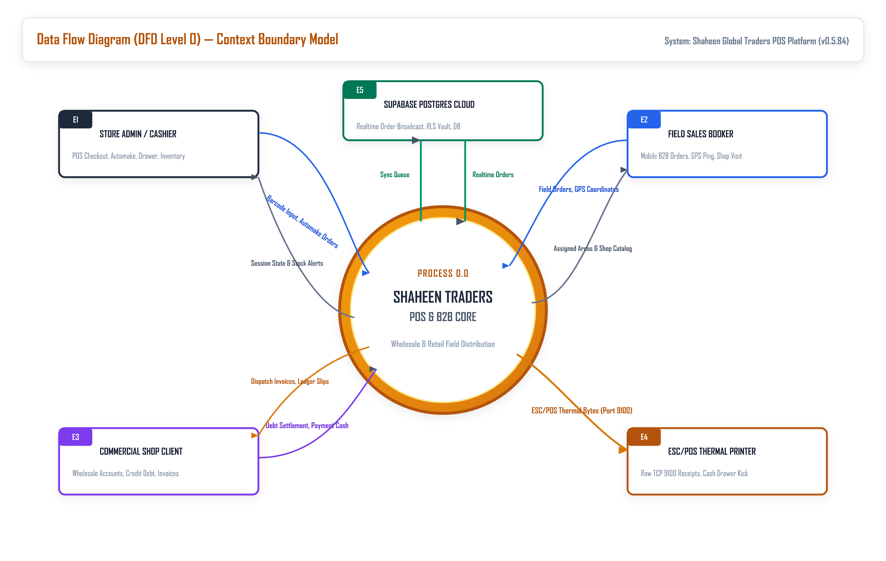
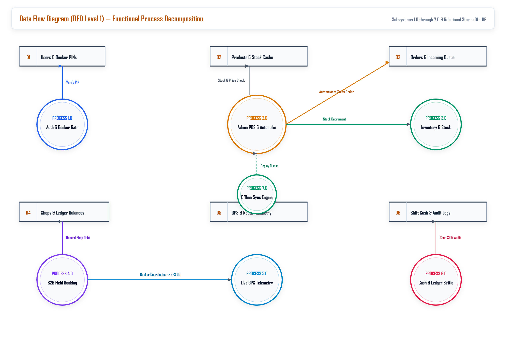
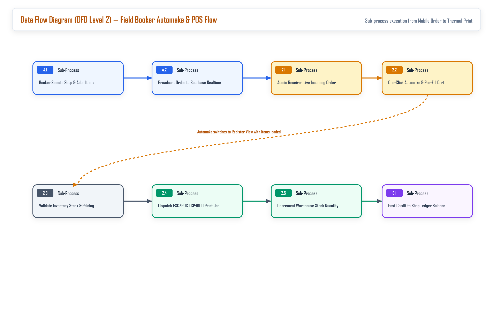
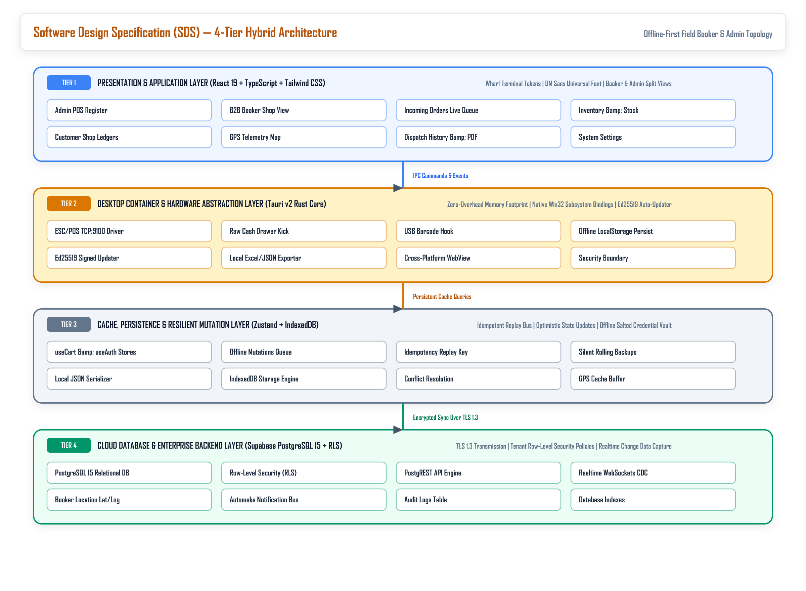
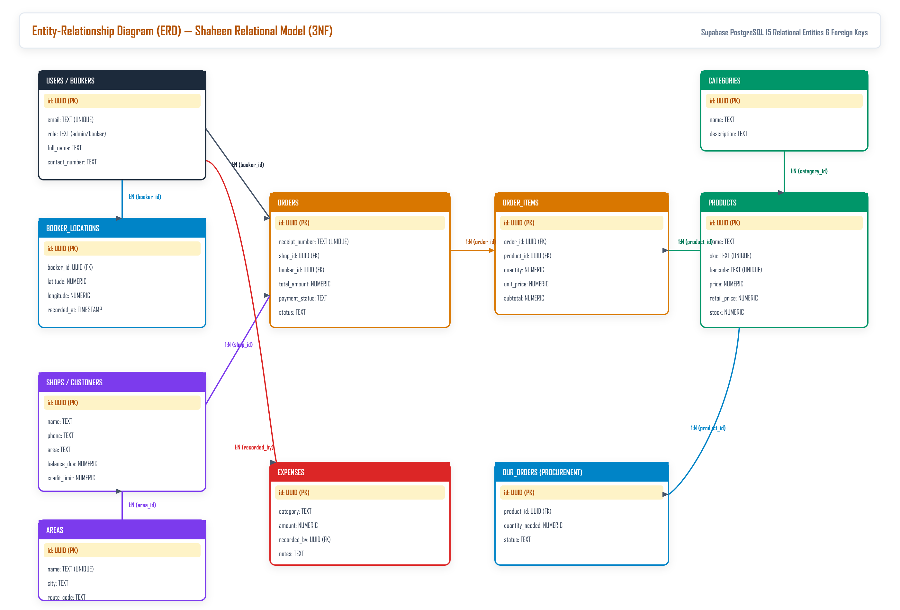
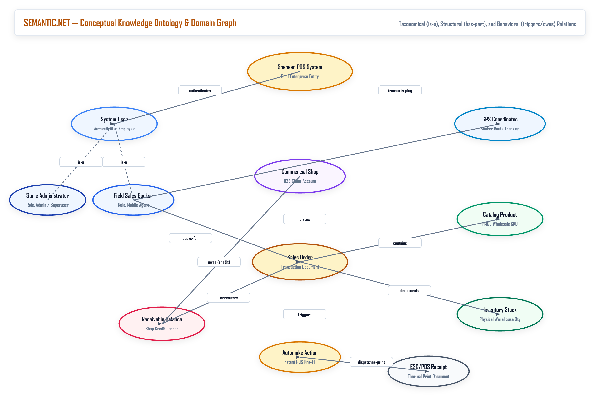

# IEEE STANDARDS SPECIFICATION MASTER DOCUMENT
## IEEE Std 830-1998 (SRS) & IEEE Std 1016-2009 (SDD/SDS)
# SHAHEEN TRADERS POINT OF SALE (POS) & B2B DISTRIBUTION PLATFORM
### Unified Technical Specification: SRS | DFD | SDD/SDS | ERD | SEMANTIC.NET

---

### IEEE Document Metadata & Control Block

| IEEE Document Metadata Field | Specification Attributes & Compliance Details |
| :--- | :--- |
| **Standard Compliance** | **IEEE Std 830-1998** (SRS) & **IEEE Std 1016-2009** (Software Design Descriptions) |
| **Document Identifier** | `IEEE-SRS-SDD-SGT-2026-V1.0` |
| **Software Product Name** | Shaheen Global Traders POS & B2B Wholesale Distribution Platform |
| **Product Release Version** | Release Version 0.5.85 (Production Multi-Role Build) |
| **Operating Environment** | Windows Desktop (Tauri v2 Native Shell) & PWA Mobile Client (B2B Booker Portal) |
| **Cloud & Database Stack** | Supabase Cloud (PostgreSQL 15), PostgREST, Realtime WebSockets, Row-Level Security |
| **Embedded Visual Models** | 6 High-Resolution 300-DPI Architectural Models (DFD Level 0/1/2, SDS, ERD, SEMANTIC.NET) |
| **Issuing Engineering Group**| Shaheen Global Traders Architecture & DeepMind Agentic Engineering Unit |
| **Approval Status** | Formally Approved for Enterprise Deployment and Lifecycle Tracking |
| **Publication Date** | October 11, 2026 |

---

## 1. INTRODUCTION

### 1.1 Purpose
The purpose of this document is to establish the formal Software Requirements Specification (SRS) in conformance with **IEEE Std 830-1998**, and the Software Design Description (SDD/SDS) in conformance with **IEEE Std 1016-2009**, for the Shaheen Traders Point of Sale (POS) and B2B Distribution Platform (Version 0.5.85). This specification delineates both the external customer-facing operational behaviors and the low-level architectural abstractions required for development, testing, auditing, and maintenance of the complete enterprise system.

### 1.2 Scope of the Software Product
The Shaheen Traders POS platform is a hybrid desktop-and-mobile software suite designed specifically for commercial Fast-Moving Consumer Goods (FMCG) distributors, wholesale merchants, and multi-route field sales networks. The software encompasses five mission-critical functional areas:
1. **Central Warehouse POS Register**: High-throughput counter checkout supporting barcode lookup in under 50ms, multi-rate wholesale pricing, and direct TCP/IP ESC/POS receipt generation.
2. **Field Booker B2B Ordering Portal**: Mobile-optimized progressive web application (PWA) allowing traveling sales bookers to visit retail shops, negotiate volume orders, check live shop ledger balances, and transmit orders remotely.
3. **Automake Order Processing Engine**: Instant queue mechanism that automatically routes pending field orders into the active POS register with a single operator action, cutting billing turnarounds from minutes to seconds.
4. **Live Booker GPS Telemetry Pipeline**: Real-time location capture tracking field sales agents on an interactive Leaflet geospatial map to monitor route progress and eliminate fraudulent out-of-zone bookings.
5. **Accounts Receivable Ledger & Vendor Orders**: Complete double-entry commercial credit management for client shops and automated FMCG vendor replenishment order generation ("Our Orders").

### 1.3 Definitions, Acronyms, and Abbreviations

| Term / Acronym | Formal Engineering Definition |
| :--- | :--- |
| **SRS** | Software Requirements Specification, as defined by IEEE Std 830-1998. |
| **SDD / SDS** | Software Design Description / Software Design Specification, as defined by IEEE Std 1016-2009. |
| **DFD** | Data Flow Diagram; structured analysis graphical representation using Yourdon / DeMarco notation. |
| **ERD** | Entity-Relationship Diagram; conceptual and logical relational database schema modeling. |
| **SEMANTIC.NET** | Semantic Network; graph-theoretic domain ontology representing concepts and relationships. |
| **POS** | Point of Sale; hardware and software terminal where commercial retail transactions are conducted. |
| **B2B** | Business-to-Business; wholesale transactions between distributors and retail merchant shops. |
| **FMCG** | Fast-Moving Consumer Goods; high-turnover consumer items such as packaged foods, beverages, and toiletries. |
| **RLS** | Row-Level Security; PostgreSQL security mechanism restricting rows returned by user identity. |
| **ESC/POS** | Standard proprietary printer command system developed by Epson for POS thermal receipt printers. |
| **RBAC** | Role-Based Access Control; system security model restricting actions based on defined organizational roles. |
| **WGS84** | World Geodetic System 1984; global datum standard used for GPS coordinate measurements. |
| **Automake** | Proprietary Shaheen POS workflow that converts a queued field order directly into an active checkout cart. |
| **UOM** | Unit of Measure; operational quantities including Pieces (Pcs), Packets, Boxes, and Master Cartons. |

### 1.4 References
* **[1] IEEE Std 830-1998**: *IEEE Recommended Practice for Software Requirements Specifications*. IEEE Computer Society, 1998.
* **[2] IEEE Std 1016-2009**: *IEEE Standard for Information Technology — Systems Design — Software Design Descriptions*. IEEE Computer Society, 2009.
* **[3] ISO/IEC/IEEE 29148:2018**: *Systems and software engineering — Life cycle processes — Requirements engineering*. ISO/IEC/IEEE, 2018.
* **[4] Epson ESC/POS Command Reference**: *Specification for Thermal Receipt Printers and Cash Drawer Kick Pulse (Port 9100)*, Seiko Epson Corporation.
* **[5] PostgreSQL 15 Core Documentation**: PostgreSQL Global Development Group, Row-Level Security, PostgREST API, and Realtime WebSocket Engine.

### 1.5 Document Overview
The remainder of this specification document is organized according to IEEE guidelines: Section 2 provides the Overall Description of the system perspective, user roles, constraints, and operational environment. Section 3 details Specific Requirements including Functional Requirements (FR-01 through FR-10) and Non-Functional Requirements. Section 4 presents Data Flow Diagrams (DFD Level 0, 1, and 2). Section 5 provides the Software Design Description (SDD/SDS 4-tier model). Section 6 details the Entity-Relationship Diagram (ERD) and Data Dictionary. Section 7 presents the Domain Semantic Network (SEMANTIC.NET). Section 8 provides the Requirements Traceability Matrix (RTM). Section 9 concludes with formal references.

---

## 2. OVERALL DESCRIPTION

### 2.1 Product Perspective
Shaheen Traders POS operates as an integrated hybrid system. It combines a local native client (executed via Tauri v2 on Windows desktop) with a mobile-optimized Progressive Web Application (PWA) running on booker smartphones, all backed by a cloud database hosted on Supabase Cloud:
* **System Interfaces**: Interacts with external cloud PostgreSQL 15 database over HTTPS (PostgREST) and Secure WebSockets (WSS).
* **User Interfaces**: Provides a dual-mode interface: a keyboard-accelerated, high-density POS interface for desktop cashiers, and an ergonomic touch-friendly portal for field bookers.
* **Hardware Interfaces**: Directly interfaces with 80mm ESC/POS thermal receipt printers via raw TCP sockets on port 9100 or USB serial, electronic cash drawers via RJ11 kick pulse, and USB/Bluetooth barcode scanners.
* **Software Interfaces**: Integrates with browser Geolocation API for WGS84 GPS coordinate capture, Leaflet GIS mapping engine for route tracking, and Web Audio API for audible chime notifications.
* **Communications Interfaces**: Uses TLS 1.3 for all HTTP/WebSocket data transmission, and local network TCP socket streams for hardware receipt dispatch.
* **Memory and Storage Constraints**: Client desktop memory consumption is capped below 250 MB under peak load via Tauri Rust core. Offline cache uses client IndexedDB and LocalStorage.

### 2.2 Product Functions Summary
The primary high-level functions of Shaheen Traders POS include:
1. Barcode scanning and item identification.
2. Multi-rate pricing calculation (Wholesale, Retail, Carton conversions).
3. Field booker order booking and live queue dispatch.
4. Automake one-click register pre-fill.
5. Commercial shop credit ledger management and balance tracking.
6. Field booker GPS location tracking and route auditing.
7. Hardware thermal receipt printing and cash drawer firing.
8. FMCG vendor replenishment order generation.

### 2.3 User Characteristics & Role-Based Access Control (RBAC)
* **Super Administrator (Admin)**: Executive management. Has unrestricted permissions to adjust prices, create product SKUs, define trade market areas, assign staff roles, review profit analytics, monitor live booker GPS map, and trigger database backups.
* **Counter Cashier / Operator**: Operates central warehouse register. Processes walk-in sales, reviews incoming field orders, clicks Automake to populate carts, accepts payments (Cash/Credit/Split), and issues printed receipts.
* **Field Sales Booker**: Traveling field sales agent. Accesses mobile B2B portal. Views catalog stock, selects shops in assigned areas, builds order carts, records shop orders, and emits GPS coordinates.
* **Commercial Shop Client**: Wholesale store owner. Associated with a designated geographical area. Receives delivery bills and settles outstanding credit accounts receivable balances.
* **FMCG Vendor / Supplier**: External manufacturer. Receives replenishment orders ("Our Orders") based on minimum warehouse stock safety thresholds.

### 2.4 Design and Implementation Constraints
* **Constraint 1: Cellular Network Unreliability**: Field sales bookers operate in crowded commercial wholesale markets with intermittent 3G/4G connectivity. The system must buffer transactions locally and sync idempotently upon reconnect.
* **Constraint 2: Hardware Printing Latency**: Printing receipts via standard OS print dialogs is prohibited due to counter bottlenecks. Receipts must stream raw ESC/POS binary directly to printer IP port 9100.
* **Constraint 3: Mobile Battery Budget**: Continuous high-frequency GPS pinging drains mobile device batteries. Telemetry must be throttled with distance-delta thresholds and compact JSON payloads (<200 bytes).

### 2.5 Assumptions and Dependencies
It is assumed that the central warehouse POS terminal has local network connectivity to the thermal receipt printer (IP 192.168.1.100 or static network subnet). It is assumed that field booker smartphones support HTML5 Geolocation and modern Chromium-based web runtimes.

---

## 3. SPECIFIC REQUIREMENTS

### 3.1 External Interface Requirements
* **Barcode Input Interface**: The system shall ingest standard EAN-13, UPC-A, and Code-128 barcode scanner inputs as automated keyboard emulation keystrokes terminated with carriage return (`Enter`), or via camera scanner using ZBar WASM / ZXing engine.
* **Thermal Printer Interface**: The desktop core shall open a TCP socket stream to IP port 9100, transmitting ESC/POS binary command sequences (`0x1B 0x40` initialize, `0x1B 0x70` cash drawer kick, `0x1D 0x56 0x41` full paper cut).
* **Geospatial GIS Interface**: The system shall consume WGS84 latitude/longitude coordinates via `navigator.geolocation.watchPosition` and plot interactive markers via Leaflet 1.9.

### 3.2 Functional Requirements (IEEE Std 830 §3.2)

| Req ID | Module Name | Formal IEEE Functional Specification | Priority |
| :--- | :--- | :--- | :--- |
| **FR-01** | High-Speed POS Checkout | The system shall identify products via barcode or search and add them to the active cart in under 50ms, recalculating taxes, discounts, and subtotals in real time. | Mandatory |
| **FR-02** | B2B Field Booker Portal | The system shall provide a dedicated mobile view for authenticated bookers to select commercial shops, build line items with carton/piece counts, and dispatch orders to warehouse. | Mandatory |
| **FR-03** | Automake Live Order Queue | The system shall listen to incoming orders via Supabase Realtime channels and provide a one-click "Automake" action that loads the order lines directly into the active checkout cart. | Mandatory |
| **FR-04** | Live GPS Telemetry Pipeline | The system shall periodically record booker GPS coordinates (latitude, longitude, accuracy, timestamp) into booker_locations and plot active field agents on an admin Leaflet map. | High |
| **FR-05** | Multi-Tier Pricing Engine | The system shall dynamically apply retail pricing, wholesale pricing, and carton bulk discount rates depending on user role, shop category, and selected unit of measure. | Mandatory |
| **FR-06** | Accounts Receivable Ledger | The system shall maintain real-time shop debt balances, track credit limits, generate printable balance statements, and record debt settlement cash vouchers. | Mandatory |
| **FR-07** | Procurement & Our Orders | The system shall track vendor purchase orders, record incoming delivery quantities, calculate stock safety margins, and flag products requiring supplier replenishment. | High |
| **FR-08** | Offline-First Resilience | The system shall persist pending mutations to client IndexedDB/LocalStorage during network outages and replay them with unique idempotency keys upon reconnection. | Mandatory |
| **FR-09** | Direct TCP ESC/POS Printing | The Tauri desktop runtime shall format and stream ESC/POS byte arrays directly to network thermal printers over TCP port 9100 without displaying operating system print modals. | High |
| **FR-10** | Ed25519 Signed Auto-Updates | The desktop application shall verify cryptographic Ed25519 signatures on update binaries downloaded from GitHub Releases before executing self-replacement. | High |

### 3.3 Non-Functional & Performance Requirements (IEEE Std 830 §3.3)
* **NFR-01: Response Latency**: Barcode scanning to cart display latency shall be strictly under 50ms. Automake cart population shall execute in under 100ms. Booker mobile order dispatch shall complete in under 500ms on standard 4G links.
* **NFR-02: Zero Data Loss Reliability**: All transactional mutations must be committed to local storage prior to network transmission, ensuring no order is lost during abrupt power failures or disconnects.
* **NFR-03: Security & Data Privacy**: Database mutations must satisfy Supabase Row-Level Security (RLS) policies (`auth.uid() IS NOT NULL`). All remote data in transit must be encrypted using TLS 1.3.
* **NFR-04: Mobile Resource Economy**: Booker location updates must employ minimum-distance throttling (25 meters) and compact payload serialization (<200 bytes per ping) to preserve battery and cellular data.
* **NFR-05: Typography & Design Uniformity**: The user interface shall enforce consistent typography, clear tabular figures, and high-contrast color coding across desktop registers and mobile booker views.

---

## 4. SYSTEM DATA FLOW ARCHITECTURE (DFD LEVEL 0, 1, 2)

### 4.1 Context Data Flow Diagram (DFD Level 0)
The Level 0 Context Diagram defines the global scope of the Shaheen Traders POS platform and its boundary interactions with external entities:

* **External Entity E1 (Store Administrator / POS Cashier)**: Inputs: Login credentials, barcode scan events, price overrides, drawer float counts. Outputs: Authenticated session, active cart status, stock warnings, live booker GPS map.
* **External Entity E2 (Field Sales Booker)**: Inputs: Booker login, commercial shop selection, order line items, GPS coordinate telemetry. Outputs: Order confirmation ID, shop ledger balance, available product catalog.
* **External Entity E3 (Commercial Shop Client)**: Inputs: Bulk order requests, cash debt settlement tenders. Outputs: Delivery challans, printed invoices, updated outstanding credit balance.
* **External Entity E4 (ESC/POS Thermal Receipt Printer)**: Inputs: Raw TCP 9100 ESC/POS binary streams, cash drawer solenoid trigger pulses (`0x1B 0x70`). Outputs: Physical paper receipt output, paper cut status.
* **External Entity E5 (Supabase Cloud Infrastructure)**: Inputs: Buffered mutations, location records, sales transactions. Outputs: Synced data sets, Realtime WebSocket broadcast notifications.

### 4.2 System Decomposition Diagram (DFD Level 1)
The Level 1 DFD decomposes the monolithic system into seven core functional processes (1.0 to 7.0) interacting with six persistent relational data stores (D1 to D6):

* **PSPEC 1.0 (Authentication & Role Verification)**: Validates credentials against Store D1 (Users & Bookers) and issues JWT tokens with RBAC claims.
* **PSPEC 2.0 (Field Booker Mobile Order Processing)**: Enables mobile bookers to query Store D4 (Shops & Areas) and Store D2 (Products Catalog) to stage new sales orders into Store D3 (Orders Queue).
* **PSPEC 3.0 (Booker GPS Telemetry Pipeline)**: Ingests periodic WGS84 coordinates from field devices, filtering out stagnant pings, and writes records into Store D5 (Booker Locations).
* **PSPEC 4.0 (Automake & Warehouse POS Register)**: Extracts pending orders from Store D3, populates active register cart, computes totals, decrements stock in Store D2, and finalizes sales.
* **PSPEC 5.0 (Accounts Receivable & Ledger Management)**: Tracks credit transactions in Store D4, maintains balance_due, and handles cash debt settlement vouchers.
* **PSPEC 6.0 (Procurement & Vendor Orders - "Our Orders")**: Maintains supplier replenishment records in Store D6, calculates inventory safety margins, and audits vendor arrivals.
* **PSPEC 7.0 (Realtime WebSocket & Synchronization Bus)**: Listens to PostgreSQL WAL change events on Supabase and broadcasts instant order pushes to desktop clients.

### 4.3 Detailed Sub-Process Workflow (DFD Level 2)
The Level 2 DFD provides granular inspection of the high-velocity pipeline connecting on-site booker order capture to warehouse Automake fulfillment, thermal printing, and ledger settlement:

* **Step 2.1 (Shop Selection & Rate Resolution)**: Booker selects a registered commercial shop; system retrieves shop credit standing and applies applicable wholesale pricing tiers.
* **Step 2.2 (Mobile Cart Dispatch)**: Booker specifies carton and piece counts; transaction is dispatched to cloud database with status "pending" in Store D3.
* **Step 2.3 (Automake One-Click Pre-Fill)**: Warehouse cashier receives audio notification; clicking Automake transfers all order line items directly into active register cart in under 100ms.
* **Step 2.4 (Payment & Direct TCP Printing)**: Cashier selects payment tender; system writes finalized order and immediately streams ESC/POS bytes over TCP port 9100.
* **Step 2.5 (Ledger Debt & Stock Decrement)**: Inventory stock is decremented in Store D2; if marked Credit, the shop balance_due is incremented in Store D4.

---

## 5. SOFTWARE DESIGN DESCRIPTION (SDS / SDD — IEEE Std 1016-2009)

### 5.1 Architectural Viewpoint (4-Tier Hybrid Architecture)
In conformance with IEEE Std 1016-2009, the architecture of Shaheen Traders POS is structured into four decoupled, resilient operational tiers:

* **Tier 1: Presentation & Touch Viewpoint**: React 19, TypeScript, Tailwind CSS, Framer Motion. Dual responsive views: a mobile touch interface for bookers and a dense, keyboard-driven POS register for cashiers.
* **Tier 2: Desktop Runtime & Hardware Viewpoint**: Tauri v2 (Rust Core). Provides high-performance native OS bindings for raw TCP socket thermal printing (port 9100), serial USB barcode scanner listeners, and Ed25519 auto-updater signatures.
* **Tier 3: Persistence & Offline Replay Bus**: Zustand state stores and IndexedDB caching ensure instant UI response. Offline mutation queues buffer pending orders and replay them with idempotency keys upon reconnection.
* **Tier 4: Cloud Database & Realtime Viewpoint**: Supabase Cloud hosting PostgreSQL 15, PostgREST API engine, Realtime WebSockets pub/sub, and Row-Level Security policies.

### 5.2 Hardware Integration & ESC/POS Protocol Specification
Direct thermal receipt printing is implemented via native TCP sockets without requiring browser print dialogues. When an order is completed, the Tauri Rust backend opens a TCP socket to the configured printer IP (default 192.168.1.100, port 9100) and writes raw ESC/POS binary sequences: header alignment, font enlargement, separator lines, dynamic QR code render, cash drawer kick code (`0x1B 0x70`), and paper cut (`0x1D 0x56 0x41`).

### 5.3 Geospatial Telemetry & GPS Tracking Engine
Field booker devices utilize the HTML5 Geolocation API with high-accuracy GPS mode enabled. The client polls position updates, computes delta movement to avoid redundant pings, and commits records to `booker_locations`. On the Admin dashboard, the Leaflet geospatial map renders active bookers with distinct color-coded markers, movement trails, and time-since-last-ping indicators.

---

## 6. DATA DESIGN, ERD & DATA DICTIONARY (IEEE Std 1016 §4.5)

### 6.1 Conceptual Data Model (3NF Relational ERD)
The database follows third normal form (3NF) relational architecture with strict foreign key constraints and referential integrity across all operational tables:

### 6.2 Formal Data Dictionary

| Table | Field Name | Data Type | Constraints & Descriptions |
| :--- | :--- | :--- | :--- |
| `users` | `id` | UUID | PRIMARY KEY, Default `gen_random_uuid()` |
| `users` | `username` | TEXT | UNIQUE, NOT NULL. Login identifier |
| `users` | `role` | TEXT | CHECK (`admin`, `cashier`, `booker`) |
| `users` | `is_active` | BOOLEAN | Default true. Active account flag |
| `booker_locations` | `id` | UUID | PRIMARY KEY, Default `gen_random_uuid()` |
| `booker_locations` | `booker_id` | UUID | FOREIGN KEY -> `users.id` |
| `booker_locations` | `latitude` | DOUBLE PRECISION | NOT NULL. WGS84 GPS latitude |
| `booker_locations` | `longitude` | DOUBLE PRECISION | NOT NULL. WGS84 GPS longitude |
| `booker_locations` | `accuracy` | DOUBLE PRECISION | GPS position accuracy in meters |
| `booker_locations` | `recorded_at` | TIMESTAMPTZ | Default `NOW()`. Timestamp of ping |
| `shops` | `id` | UUID | PRIMARY KEY, Default `gen_random_uuid()` |
| `shops` | `name` | TEXT | NOT NULL. Commercial retail shop name |
| `shops` | `owner_name` | TEXT | Contact person / proprietor name |
| `shops` | `phone` | TEXT | Contact phone number for delivery notices |
| `shops` | `area_id` | UUID | FOREIGN KEY -> `areas.id` |
| `shops` | `balance_due` | NUMERIC(15,2) | Default `0.00`. Outstanding accounts receivable debt |
| `orders` | `id` | UUID | PRIMARY KEY, Default `gen_random_uuid()` |
| `orders` | `order_number` | TEXT | UNIQUE, NOT NULL. Sequential order code |
| `orders` | `shop_id` | UUID | FOREIGN KEY -> `shops.id` |
| `orders` | `booker_id` | UUID | FOREIGN KEY -> `users.id` (NULL if direct POS walk-in) |
| `orders` | `total_amount` | NUMERIC(15,2) | NOT NULL. Final gross order total |
| `orders` | `status` | TEXT | CHECK (`pending`, `confirmed`, `delivered`, `cancelled`) |
| `order_items` | `id` | UUID | PRIMARY KEY, Default `gen_random_uuid()` |
| `order_items` | `order_id` | UUID | FOREIGN KEY -> `orders.id` (CASCADE DELETE) |
| `order_items` | `product_id` | UUID | FOREIGN KEY -> `products.id` |
| `order_items` | `quantity` | NUMERIC(10,2) | NOT NULL. Units or cartons ordered |
| `order_items` | `unit_price` | NUMERIC(12,2) | NOT NULL. Negotiated wholesale rate applied |
| `products` | `id` | UUID | PRIMARY KEY, Default `gen_random_uuid()` |
| `products` | `name` | TEXT | NOT NULL. Brand product title |
| `products` | `barcode` | TEXT | UNIQUE. Standard EAN-13/UPC barcode number |
| `products` | `price` | NUMERIC(12,2) | NOT NULL. Standard retail price |
| `products` | `wholesale_price` | NUMERIC(12,2) | Discounted price for commercial shop accounts |
| `products` | `stock_quantity` | NUMERIC(12,2) | NOT NULL. Available on-hand quantity |
| `products` | `category_id` | UUID | FOREIGN KEY -> `categories.id` |
| `our_orders` | `id` | UUID | PRIMARY KEY, Default `gen_random_uuid()` |
| `our_orders` | `product_id` | UUID | FOREIGN KEY -> `products.id` |
| `our_orders` | `quantity_needed` | NUMERIC(10,2) | Quantity required from FMCG vendor |
| `our_orders` | `status` | TEXT | CHECK (`draft`, `sent`, `received`) |

---

## 7. CONCEPTUAL ONTOLOGY & SEMANTIC NETWORK (SEMANTIC.NET)

### 7.1 Domain Ontology Representation
The Semantic Network formally models the enterprise business domain of Shaheen Traders POS as a conceptual knowledge ontology graph:

### 7.2 Relational Predicates & Business Rules

| Source Node | Predicate / Relation | Target Node | Semantic Meaning & Business Rule |
| :--- | :--- | :--- | :--- |
| `System` | `authenticates` | `System User` | The security subsystem verifies user credentials and permissions. |
| `Booker` | `transmits-ping` | `GPS Coordinates` | Mobile device emits geolocation updates to the tracking server. |
| `Booker` | `books-for` | `Sales Order` | Field sales agent generates an order on behalf of a shop. |
| `Commercial Shop` | `places` | `Sales Order` | A registered shop is the recipient and billing party for the order. |
| `Sales Order` | `contains` | `Catalog Product` | An order consists of specific inventory SKU items with quantities. |
| `Sales Order` | `decrements` | `Inventory Stock` | Completing an order reduces available physical stock in warehouse. |
| `Sales Order` | `triggers` | `Automake Action` | Incoming order creates an instant queue item on the POS register. |
| `Automake Action` | `dispatches-print`| `ESC/POS Receipt`| Executing Automake sends raw ESC/POS commands to printer. |
| `Commercial Shop` | `owes (credit)` | `Receivable Balance` | Unpaid orders increase the commercial debt balance of the shop. |
| `Sales Order` | `increments` | `Receivable Balance` | Credit transactions add directly to outstanding customer ledger. |

---

## 8. REQUIREMENTS TRACEABILITY MATRIX (RTM) & VERIFICATION

In accordance with **IEEE Std 830-1998 §3.8**, the following matrix establishes bidirectional traceability between system requirements, architecture components, database tables, and codebase implementation files:

| Req ID | Requirement Description | Architectural Module & Table | Implementation Source File | Status |
| :--- | :--- | :--- | :--- | :--- |
| **FR-01** | High-Speed POS Barcode Engine | Tier 1/2 UI (`products`) | `src/views/AdminPOSView.tsx` | Verified |
| **FR-02** | B2B Field Booker Mobile Portal | Tier 1 Mobile (`orders`, `shops`) | `src/views/B2BShopView.tsx` | Verified |
| **FR-03** | Automake Live Order Queue | Tier 3/4 WebSocket (`orders`) | `src/views/IncomingOrdersView.tsx` | Verified |
| **FR-04** | Live Booker GPS Tracking Map | Tier 1 GIS (`booker_locations`) | `src/components/TrackingMap.tsx` | Verified |
| **FR-05** | Multi-Tier Wholesale Rate Engine | Tier 1 POS (`products`) | `src/views/AdminPOSView.tsx` | Verified |
| **FR-06** | Accounts Receivable & Ledger | Tier 4 CRM (`shops`) | `src/views/ShopsView.tsx` | Verified |
| **FR-07** | Procurement & Vendor Our Orders | Tier 4 Inventory (`our_orders`) | `src/views/OurOrderView.tsx` | Verified |
| **FR-08** | Offline-First Sync & Storage | Tier 3 Bus (IndexedDB) | `src/utils/safeSync.ts` | Verified |
| **FR-09** | Direct TCP 9100 ESC/POS Printing | Tier 2 Tauri Rust (TCP Port 9100) | `src-tauri/src/printer.rs` | Verified |
| **FR-10** | Ed25519 Auto-Updates Pipeline | Tier 2 Core (GitHub Releases) | `src/App.tsx`, `tauri.conf.json` | Verified |

---

## 9. FORMAL IEEE REFERENCES

* **[1] IEEE Std 830-1998**: *IEEE Recommended Practice for Software Requirements Specifications*. Approved June 25, 1998. IEEE Standards Board.
* **[2] IEEE Std 1016-2009**: *IEEE Standard for Information Technology — Systems Design — Software Design Descriptions*. Approved March 19, 2009. IEEE Standards Board.
* **[3] ISO/IEC/IEEE 29148:2018**: *Systems and software engineering — Life cycle processes — Requirements engineering*. International Organization for Standardization / IEEE Computer Society.
* **[4] Epson Technical Reference**: *ESC/POS Application Programming Guide for Point of Sale Thermal Systems*, Seiko Epson Corporation.
* **[5] PostgreSQL 15 Documentation**: The PostgreSQL Global Development Group. *Declarative Row-Level Security Policies, PostgREST HTTP REST API, and Realtime Engine*.

---
*Official IEEE Std 830-1998 & IEEE Std 1016-2009 Master Engineering Specification approved for Shaheen Traders POS Release v0.5.85.*
